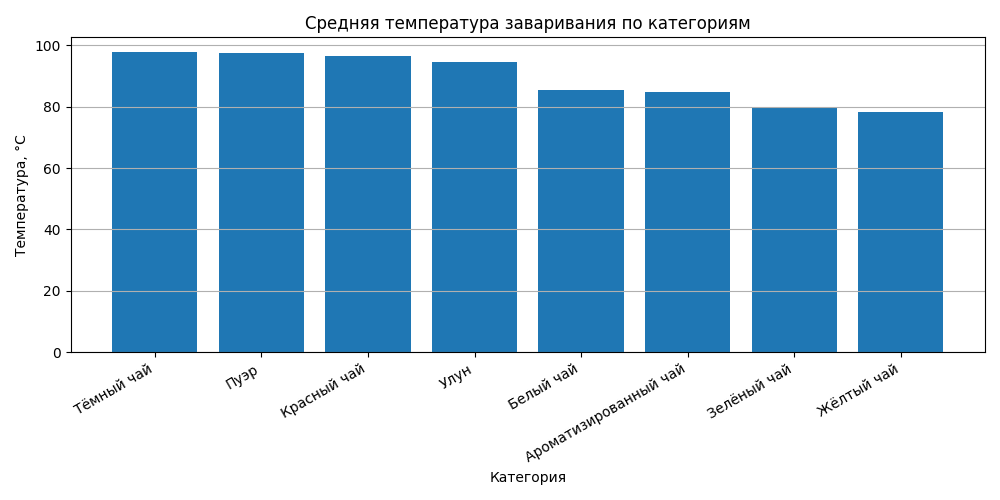
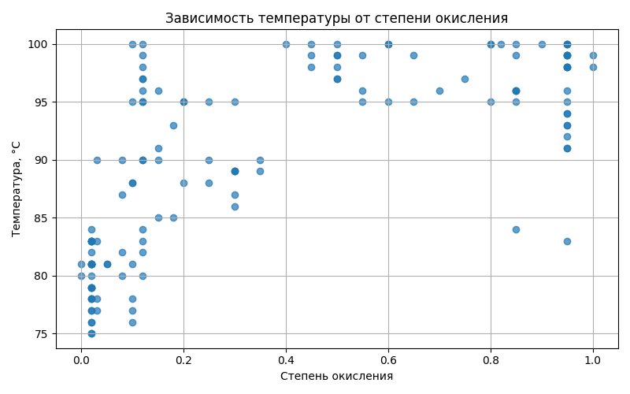

# Telegram-бот: помощник по завариванию китайского чая

Проект в рамках учебного курса. Бот помогает пользователям правильно заваривать китайский чай, подбирая идеальную температуру воды, время настаивания и количество проливов.

## Этап 2: Генерирование данных

На данном этапе был собран исходный датасет и сгенерированы недостающие параметры для заваривания.

### Файлы в репозитории:

- `chinese-tea-dataset.json` — исходный датасет (136 сортов чая), собранный с открытых источников (chinatea.house).
- `generate_tea.py` — Python-скрипт. Он читает исходный JSON, логически генерирует температуру и время заваривания (в зависимости от типа чая и степени окисления), а также переводит все категории, названия и вкусовые профили на русский язык.
- `tea_dataset_ru.csv` — итоговый, очищенный и дополненный датасет, готовый для аналитики (Этап 3) и интеграции в Telegram-бота.

### Как воспроизвести результат:

pip install pandas
python generate_tea.py

## Этап 3: Анализ данных

На этом этапе я посмотрел на сгенерированный датасет, чтобы понять, какие параметры реально различаются между типами чая и имеет ли смысл вообще делать бота с подсказками по завариванию. Анализ сделан с использованием pandas, numpy и matplotlib, по мотивам лекций 7–9.

### Файлы в репозитории:

- `analysis.py` — скрипт анализа. Читает `tea_dataset_ru.csv`, считает статистику по категориям, строит графики и сохраняет их в папку `images`.
- `tea_stats_by_category.csv` — сводная таблица средних параметров заваривания по каждой категории (температура, время, число проливов). Пригодится дальше при интеграции в бота.
- `images/` — папка с графиками: распределение сортов по категориям, средняя температура и время по типам, гистограмма температур, scatter окисления и температуры.

### Что показал анализ

Больше всего в базе улунов и зелёного чая, так что боту в первую очередь надо корректно работать именно с ними.

По температуре типы чая сильно расходятся. Зелёный и белый завариваются примерно на 80°C, а красный, пуэр и тёмный — на 95–100°C. Разница в 15–20 градусов, и на глаз новичок её не определит.

Время настаивания везде маленькое, 10–30 секунд, и это как раз то место, где люди чаще всего портят чай — держат его в чашке по пять минут и получают горечь. Число проливов тоже отличается в разы: у красного чая 3–5, у пуэра до 12.

Отдельно проверил, связано ли окисление с температурой. Связь положительная — чем сильнее окислен чай, тем горячее вода. Но есть отклонения: шэн пуэр окислен слабо, а заваривается кипятком. Так что по одному только окислению бот советовать не должен, параметры надо хранить для каждого типа отдельно, а окисление использовать как запасной признак.

В итоге проект получается не впустую: параметры заваривания реально разные, ошибки в них частые, и структурировать эти подсказки в бота — нормальная и полезная задача.

### Как воспроизвести результат:

pip install pandas numpy matplotlib
python analysis.py

После запуска в папке `images` появятся графики, а рядом со скриптом — файл `tea_stats_by_category.csv`.
